# Výpočetní nástroje QGIS

## Cíl cvičení

Prohloubení znalostí práce s geografickým informačním systémem QGIS s
přímou návazností na praktické úlohy realizované v rámci 9. cvičení
předmětu GIS 1 ([Volně dostupné GIS nástroje –
QGIS](https://k155cvut.github.io/gis-1/cviceni/cviceni9/)). Důraz bude
kladen na praktické řešení komplexnějších prostorových úloh a
efektivní využití výpočetních funkcí QGIS.

## Základní pojmy

- [**QGIS**](https://qgis.org) – svobodný multiplatformní geografický informační systém (GIS)
    - [**Nástroje zpracování**](https://gismentors.github.io/qgis-pokrocily/geoprocessing/index.html)
    - [**Grafický modelář**](https://gismentors.github.io/qgis-pokrocily/modeler/index.html)

## Použité datové podklady

Přehled dat, které budeme používat:

- [velkoplošná zvláště chráněná území](https://data.nature.cz/ds/3) poskytována AOPK.
- rastrová data DMT 100x100m generalizovaná za účelem ukázky
- výsek z [DMR5G](https://ags.cuzk.cz/geoprohlizec/?atom=dmr5g) pro území obce Zdiby. Data byla stažena přímo od poskytovatele a oříznuta pro rychlejší zpracování území.

Cílem je používat data přímo od jejich poskytovatelů. Pro zjednodušení
je ale připraven balíček již připravených dat
([data.zip](https://geo.fsv.cvut.cz/vyuka/155gis2/cviceni/8/data.zip)).

!!! warning

    Data lze načítat přímo ze "ZIP", ale pro další zpracování se doporučuje data rozbalit do pracovního adresáře.

## Náplň cvičení

Jako podpůrný materiál budeme používat školící materiály [QGIS pro
začátečníky](https://gismentors.github.io/qgis-zacatecnik) a [QGIS pro pokročilé](https://gismentors.github.io/qgis-pokrocily/) skupiny
[GISMentors](https://gismentors.cz).

### Opakování základního ovládání a práce v QGIS

 
V panelu `Prohlížeč/Browser` si najdeme pracovní adresář se staženými
daty. Dataset lze načít například "přetažením" datasetu do mapového
okna nebo do panelu vrstev. Načtená data je dobré zkontrolovat, zda se
používá správný [souřadnicový
systém](https://gismentors.github.io/qgis-zacatecnik/intro/import_export.html#vyber-souradnicoveho-systemu).

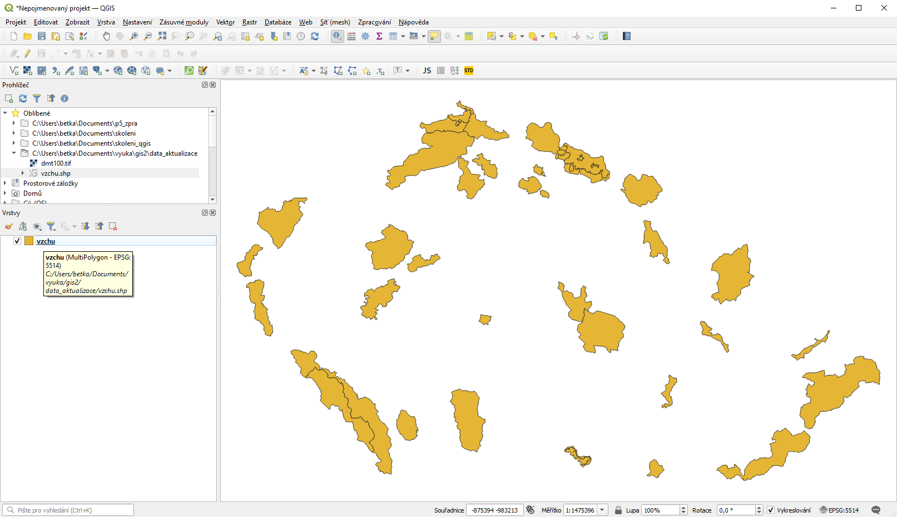

Vrstvě nastavíme kategorizovanou symbologii podle atributu "KAT".

Základní nástroje jako například obalová zóna jsou k dipozici v horním
textovém menu v položce `Vektor/Vector`, konkrétně obalová zóna je
zařazena `Vektor->Nástroje geoprocessingu->Obalová
zóna/Vector->Geoprocessing Tools->Buffer`. Můžeme si vyzkoušet
vygenerovat obalovou zónu o velikosti 1000m sloučenou pro všechny
prvky - `rozpuštěnou/dissolve`. 

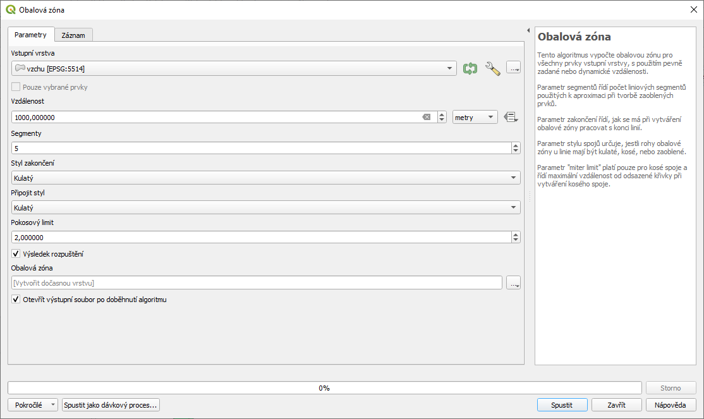
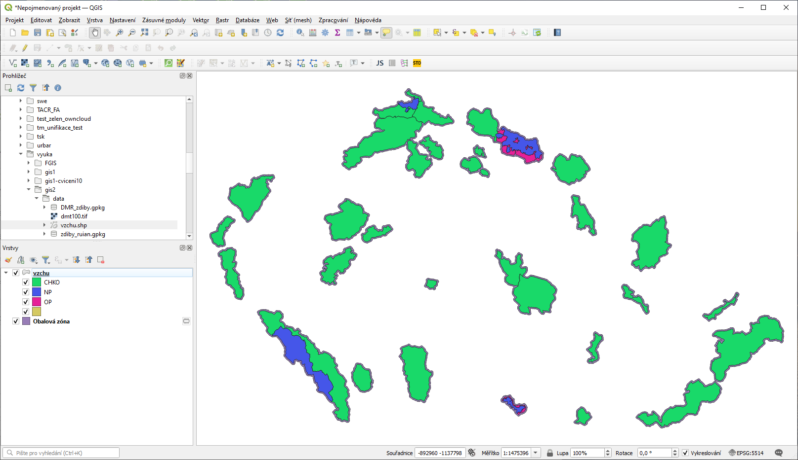

### Nástroje zpracování

Podklady:

- [Nástroje zpracování](https://gismentors.github.io/qgis-pokrocily/geoprocessing/index.html)

Menu `Nástroje zpracování/Processing` obsahuje širokou nabídku jak
základních nástrojů, tak i mnoho dalších možností. Například možnost
generování obalové zóny v různých variantách. Nástroj `Obalová zóna
vektorové vrstvy/Buffer vectors` ze skupiny GDAL nám umožní rozpustit
obalové zóny podle atributu.

Vygenerujeme obalovou zónu vrstvy VZCHU o velikosti 1000 m a parametr
pro rozpuštění dle atributu nastavíme na atribut "KAT".

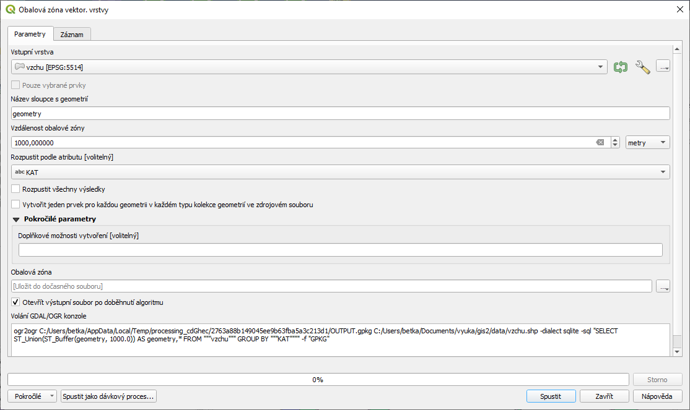

V symbologii nastavíme částečně průhlednou barvu. Díky překryvu
původní kategorizované symbologie a pokročilé obalové zóny si umíme
jednoduše zkontrolovat správnost funkcionality.

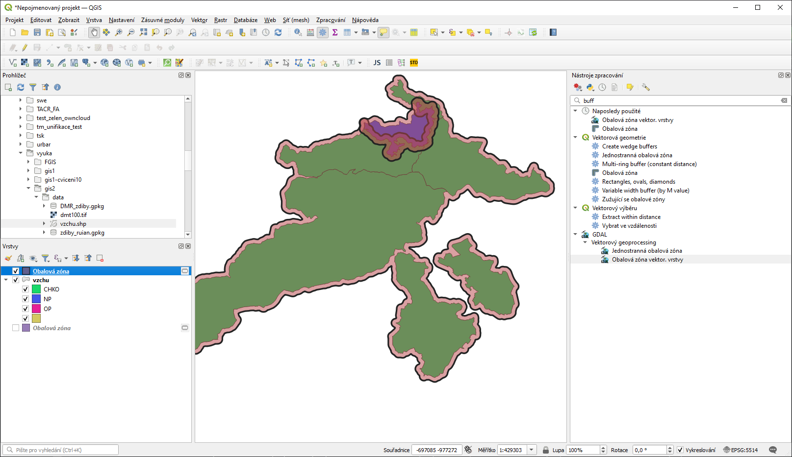

Načteme vrstvu DMT a ořežeme ji podle velkoplošných chráněných území -
nástroj `Rastr->Extrakce->Oříznout rastr podle vrstvy
masky/Raster->Extraction->Clip Raster By Mask Layer`. Zároveň
použijeme nástroj pro iteraci, který nám vytvoří samostatný výstup pro
každý prvek chráněného území.

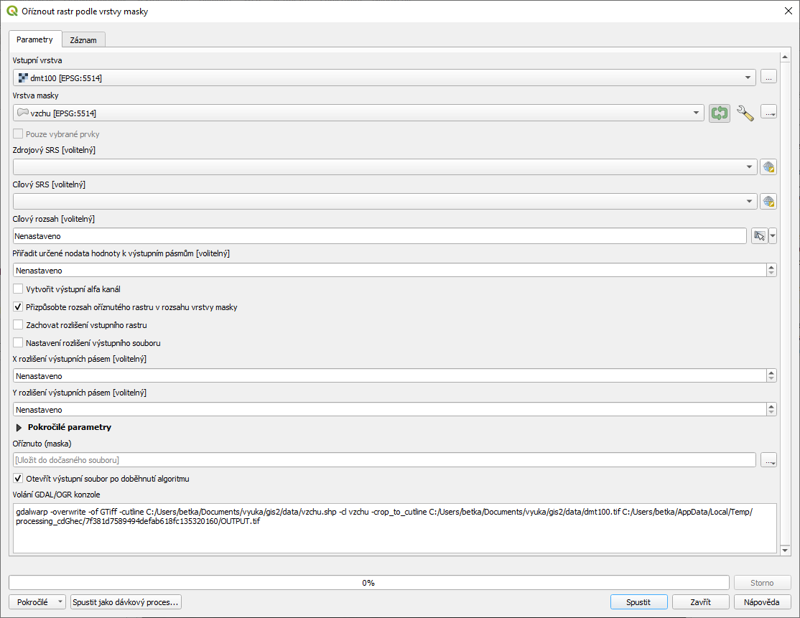

!!! task-fg-color "Otázka"

    Jaký postup by bylo nutné zvolit, aby správce každého území dostal ořezaný rastr svého území spolu s ochranným pásmem?

Další možností je používat nástroje v módu `Dávkové zpracování/Run as
Batch Process`. Otevřeme nástroj `Obalová zóna vektorové vrstvy/Buffer
vectors` ze skupiny GDAL a pomocí tlačítka `Spustit jako dávkový
proces...` se otevře nastavení pro nastavení v řádkovém
zápisu. Nastavíme velikost bufferu na 3km a rozpuštění podle atributu
"KAT".  Přidáme další 2 řádky (tlačítko `plus/Add row`), které
vyplníme pouze s rozdílem velikosti obalové zóny na 6km a 10km.  V
posledním sloupečku se nastavuje způsob výstupu. Přes tlačítko lze
zvolit výstupní soubor (`Select File/Folder`), kam zadáme název
výstupního GPKG. Následně se dialog zeptá na automatickou výplň, kde
zvolíme `Vyplnit hodnotami parametru/Fill with parameter values` a
vybereme `Vzdálenost obalové zóny/Buffer distance`. Doporučujeme
manuálně upravit na hodnotu bez desetinného místa.  Nevýhodou je, že
nelze jednoduše uložit do jednoho GPKG jako vícero vrstev.  Zaškrtneme
`Načíst vrstvy po dokončení/Load layers on completion`.

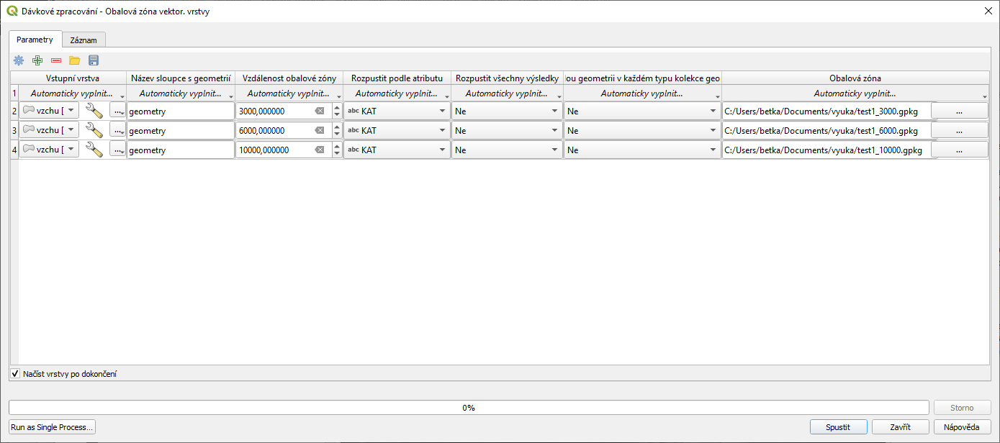

!!! tip

    Veškeré nastavení je v processingovém menu možné upravit. Rovněž je k dispozici historie procesů, odkud lze jednotlivý proces opakovaně spustit se všemi parametry.

### Grafický modelář

Podklady:

- [Grafický modelář](https://gismentors.github.io/qgis-pokrocily/modeler/index.html)

V tomto prostředí je možné sestavit řetězec algoritmů, které
zpracovávají data a ten pak spouštět jako samostatný proces. Jako
ukázku si zkusíme sestavit jednoduchý model.

1. Vytvoříme nový model (`Processing->Model Designer`)
2. Nastavíme vlastnosti modelu (název, skupina), model uložíme do souboru.

    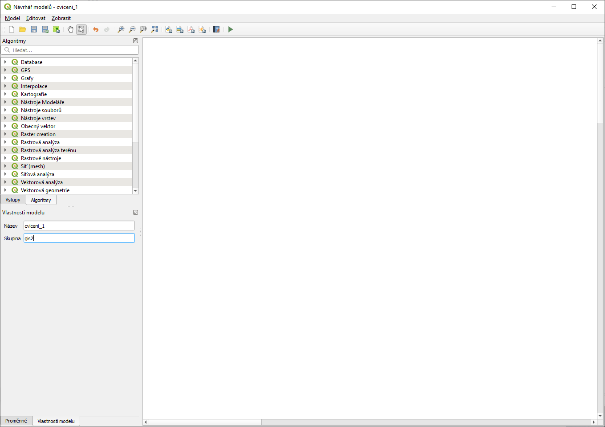

3. Přidáme vstupní parametr typu číslo (`Number`) s popisem "počet bodů", vstup bude celočíselný.

    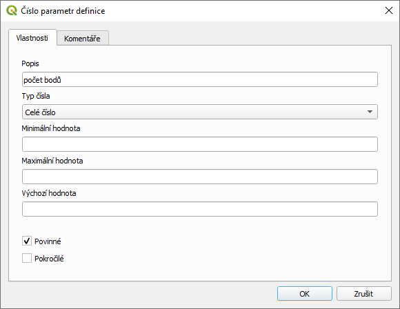

4. Přidáme vstupní parametr typu `Rozsah/Extent`. Díky překladu jsou
   tam 2 stejné hodnoty, použijeme druhý parametr s popisem "rozsah".

    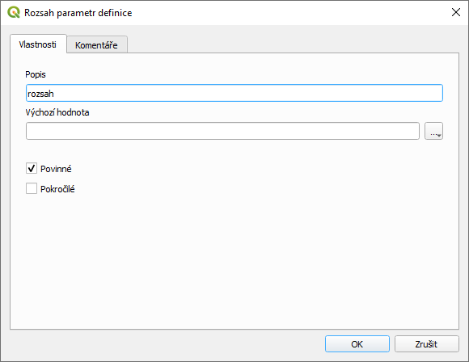

5. Přidáme algoritmy (záložka `Toolbox`) - `náhodné body v
   rozsahu/random points in extent`. Počet bodů a rozsah provážeme se
   vstupními parametry z bodu 3. a 4. (`Model input`). Nastavíme
   výstup pro kontrolu.

    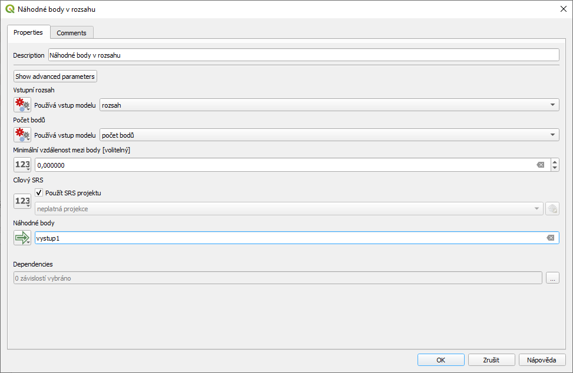

6. Model spustíme a zkontrolujeme zda se výstup generuje dle zadání.

    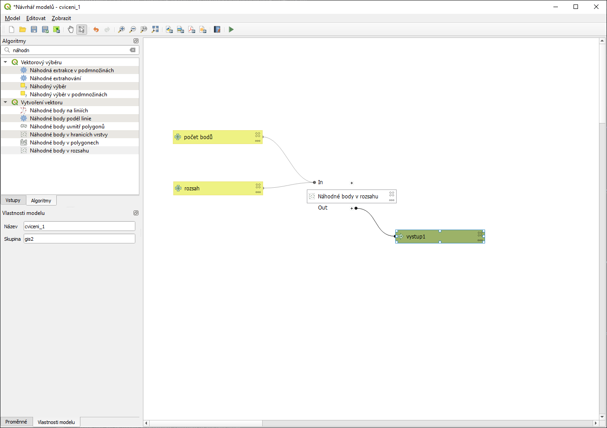
    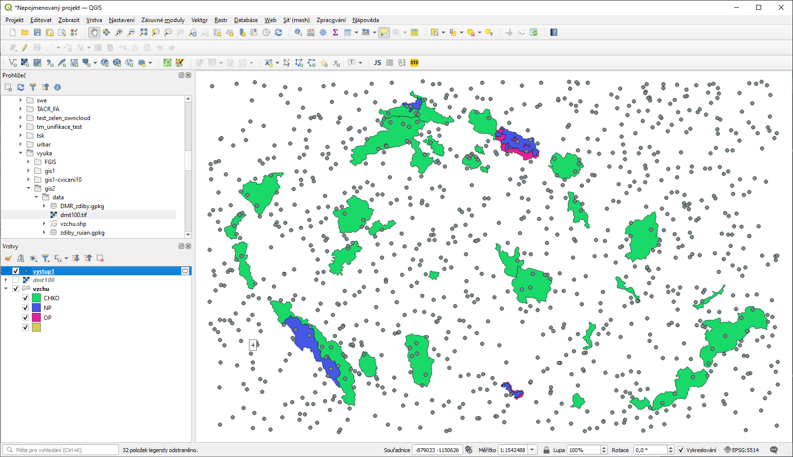

7. Model upravíme - přidáme vstupní parametr typu číslo pro zadání
   velikosti obalové zóny. Popis nastavíme jako "velikost obalové
   zóny" a nastavíme číslo jako desetinné. Výchozí hodnotu nastavíme
   jako 1000 (metrů).

    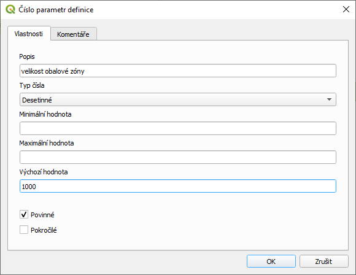

8. Model upravíme - přidáme algoritmus pro obalovou zónu, která
   vygeneruje obalovou zónu dle zadané velikosti kolem vygenerovaných
   bodů (`Algorithm Output`).

    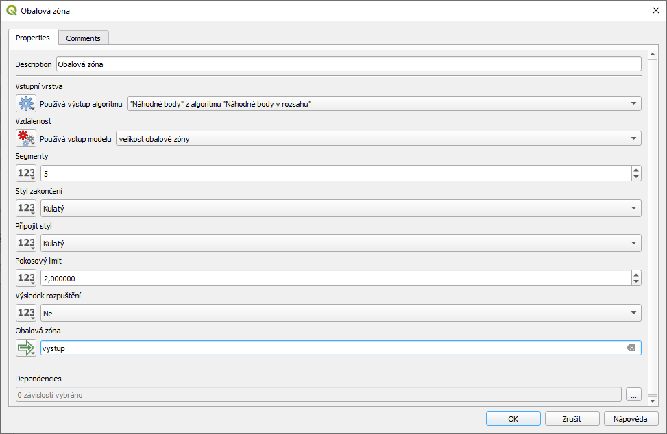

9. Model spustíme

    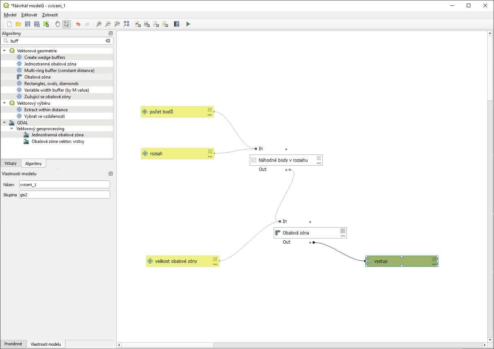

10. Upravíme nápovědu modelu (`Model->Edit Model Help`)
12. Vyzkoušíme spustit model z panelu nástrojů zpracování

!!! tip

    Vyzkoušejte si model exportovat do skriptu.

## Simulace výběru pozemků pro výstavbu dle sklonitosti

Vyberte v obci Zdiby parcely vhodné pro výstavbu: plochy se sklonem do
2° a výměrou alespoň 40 000 m².

Zjednodušeně si vyzkoušíme malou část takovéhoto postupu:

- Prvním krokem je stažení a práce s daty DMR5G.
- Druhá je pak výběr parcel (data RÚIAN) podle požadované sklonitosti.

### DMR5G

Podklady:

- [Práce s 3D daty](https://gismentors.github.io/qgis-pokrocily/3d/index.html)
- [Terénní analýzy](https://gismentors.github.io/qgis-zacatecnik/rastrova_data/rastr_terenni_analyzy.html)

Prvním krokem je výpočet výškového rastru z dat DMR5G (pro
zjednodušení použijeme předzpracovaná data "zdiby_dmr5g.gpkg"). V
nástrojích zpracování vyhledáme nástroj `TIN interpolace/TIN
interpolation`. Vstupní vrstvou jsou body z DMR5G, u kterých používáme
jejich Z souřadnici. Požadovaným výstupem bude rastr s velikostí
pixelu 2x2m v rozsahu totožném jako je vstupní vrstva.

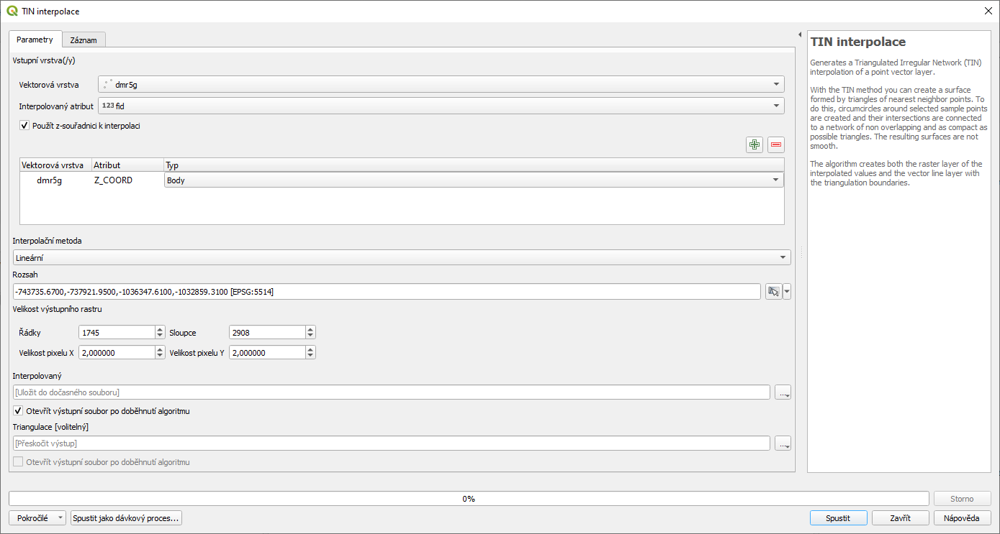

Následuje pak výpočet sklonitosti, který najdeme v menu
`Rastr->Analýza->Sklon/Raster->Analysis/Slope`. Vstupní vrstva je
výstupní výškový rastr z předešlého kroku. Další dodatečné nastavení v
tomto případě nejsou zapotřebí.

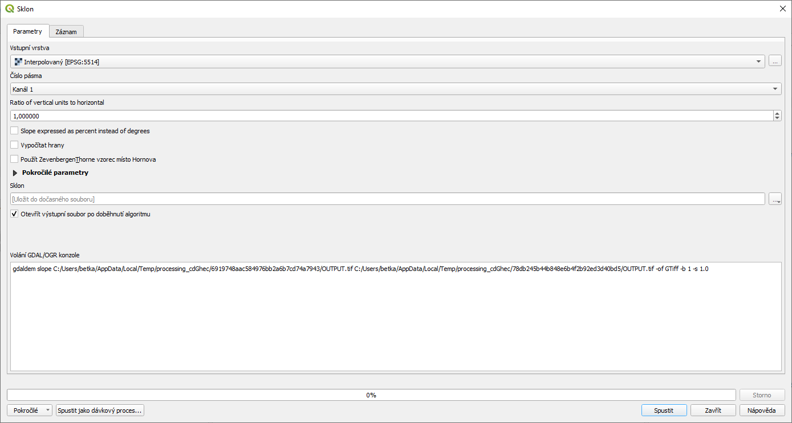

Pro další práci nás zajímají pouze plochy s sklonem menším než
2°. Použijeme nástroj `Reklasifikovat podle tabulky/Reclassify by
table`. V pravidlech nastavím reklasifikační hodnotu pro interval
`0-2° -> 1` a hodnoty mimo rozsah budou zařazena jako
NO_DATA. Výstupné vrstvě změníme symbologii na `Paleta/jedinečné
hodnoty / Paletted / Unique values` pro možnost vizuální kontroly
výstupu.

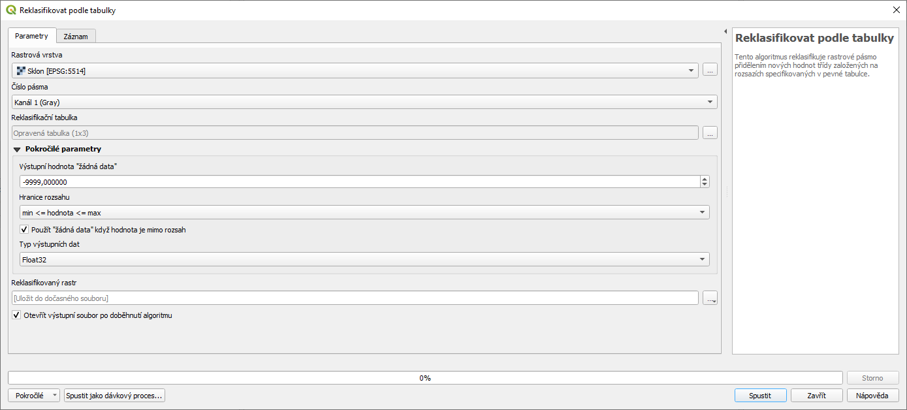

V dalším kroku je výhodné převézt vybrané plochy na polygonovou
vrstvu. Použijeme nástroj `Převézt na polygony (rastr na
vektor)/Polygonize (raster to vector)`.

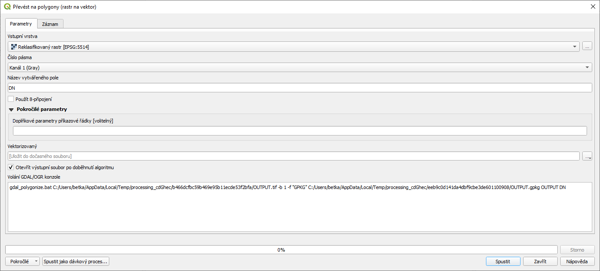

Plochy, které jsou menší než 40 000 m2 nejsou pro vybraný účel
výstavby vhodné, proto potřebujeme vybrat pouze parcely s plochou
větší než uvedená mezní hodnota. Toto nám umožní atributový dotaz s
podmínkou `$area >= 40000`. Vybrané parcely uložíme do samostatné
vrstvy.

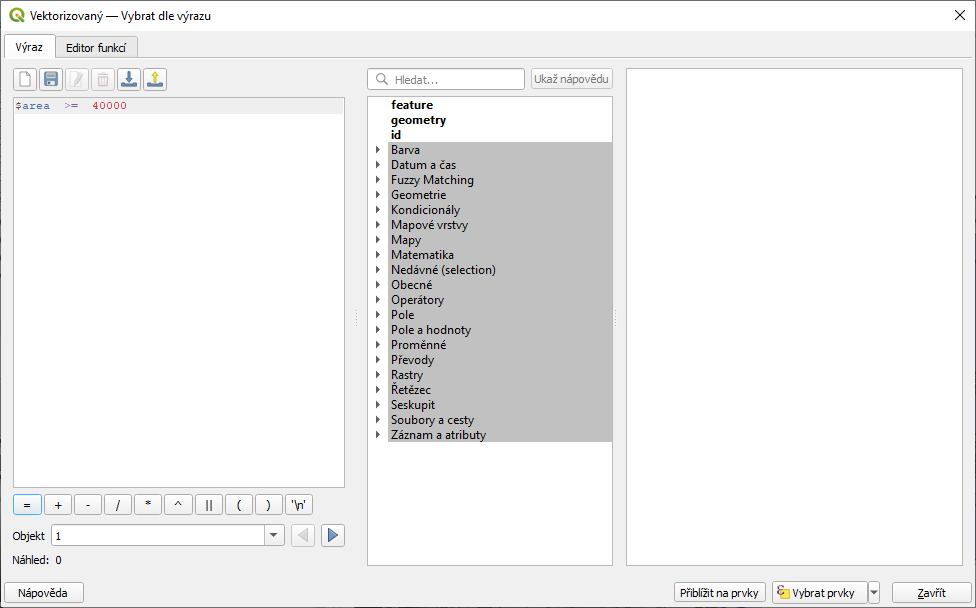

### Výběr parcel podle požadované sklonitosti

Pro výběr parcel je vhodné použít data z RÚIANu - stažení dat dle
cvičení
[GIS1](https://k155cvut.github.io/gis-1/cviceni/cviceni9/). Stáhneme
obec "Zdiby".

Následně potřebujeme ořezat parcely plochami s vhodnou svažitostí. Pro
tento krok použijeme funkci `CLIP`.

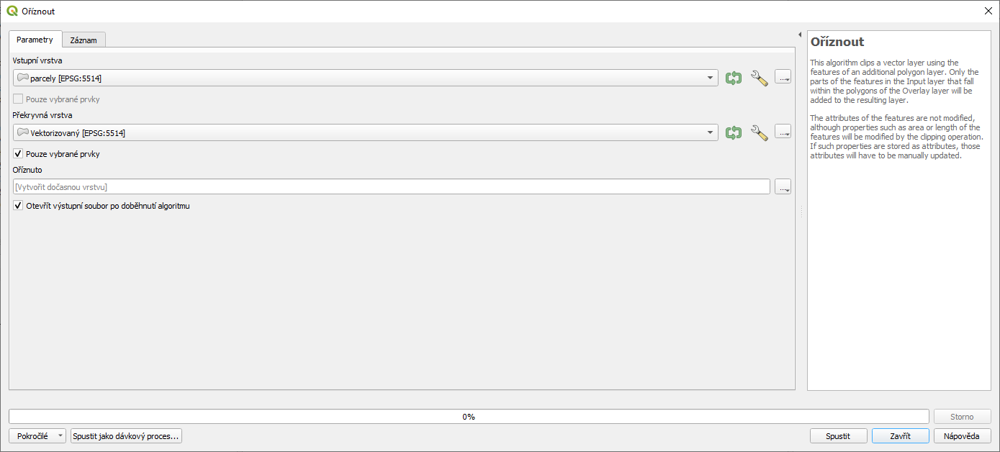
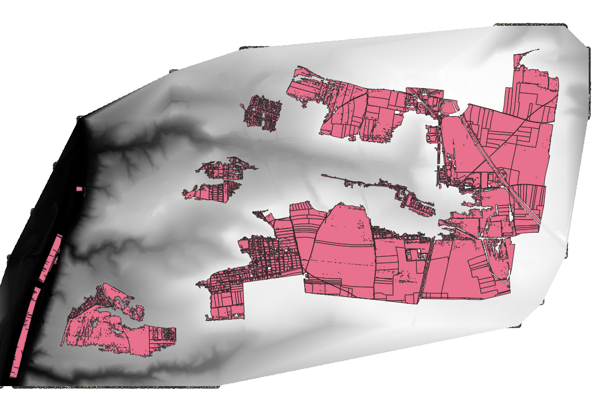

## Další úlohy k procvičení
 
1. Vytvořte model pro poslední část cvičení (Výběr parcel dle sklonitosti).
2. Vytvořte digitální model terénu z originálních dat (LAZ) stažených
   z [ČÚZK](https://ags.cuzk.cz/geoprohlizec/?atom=dmr5g)
