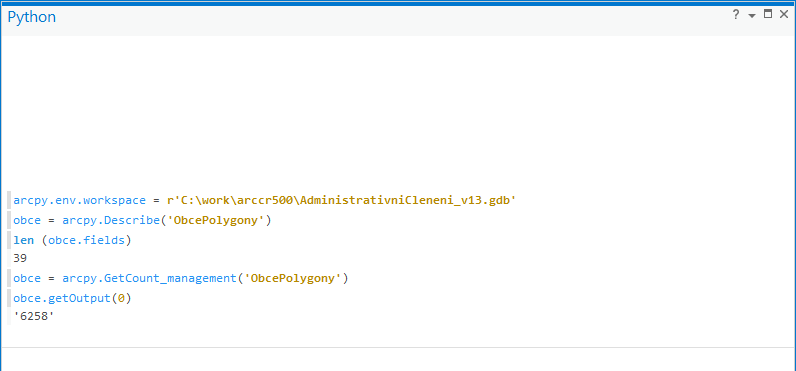
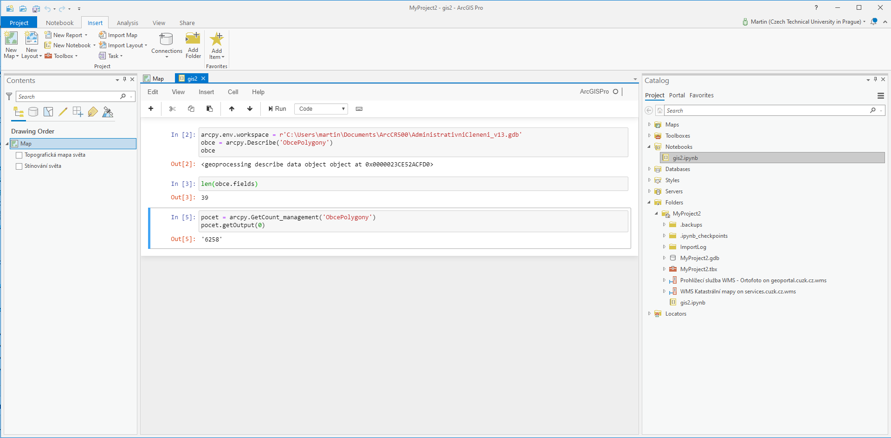

# ArcPy

## Cíl cvičení

Seznámení s Python balíčkem ArcPy.

## Základní pojmy

- **Python Window** (`View > Python Window`)
- **Jupyter Notebook** (`Insert > New Notebook`)

Užitečné odkazy:

* [Python in ArcGIS Pro](https://doc.esri.com/en/arcgis-pro/latest/arcpy/get-started/installing-python-for-arcgis-pro.html)
* [Quick tour of creating tools with Python](https://doc.esri.com/en/arcgis-pro/latest/arcpy/geoprocessing_and_python/a-quick-tour-of-creating-tools-in-python.html)
* [Introduction to ArcPy](https://doc.esri.com/en/arcgis-pro/latest/arcpy/get-started/what-is-arcpy-.html)
* [ArcGIS API for Python](https://doc.esri.com/en/arcgis-pro/latest/arcpy/get-started/arcgis-api-for-python.html)
* [Overview of the ArcGIS API for Python](https://developers.arcgis.com/python/guide/overview-of-the-arcgis-api-for-python/)
* [ArcGIS Pro Python reference](https://doc.esri.com/en/arcgis-pro/latest/arcpy/main/arcgis-pro-arcpy-reference.html)
* [Use ArcPy in a notebook](https://doc.arcgis.com/en/arcgis-online/reference/use-arcpy-in-your-notebook.htm)
* [ArcGIS API for Python: ArcGIS in a Notebook](https://www.youtube.com/watch?v=FtuHFZUrrMc) (video)

## Použité datové podklady

- [ArcČR 500](../../data/#arccr-500)

## Náplň cvičení

### Úvod

Otevřte `Python Window` a vyzkoušejte úryvek kódu níže.

```py
arcpy.env.workspace = r"S:\K155\Public\data\ArcGIS\ArcCR500 3.3\AdministrativniCleneni_v13.gdb"
obce = arcpy.Describe("ObcePolygony")
len(obce.fields)
```

Dokumentace:

- [Describe](https://doc.esri.com/en/arcgis-pro/latest/arcpy/data-access/describe.html)
  - [FeatureClass properties](https://doc.esri.com/en/arcgis-pro/latest/arcpy/functions/featureclass-properties.html)
  - [Table properties](https://doc.esri.com/en/arcgis-pro/latest/arcpy/functions/table-properties.html)

<figure markdown>
{ width="500" }
    <figcaption>Python Window</figcaption>
</figure>

Následující úlohy již můžeme řešit v prostředí Jupyter Notebooku.

<figure markdown>
{ width="500" }
    <figcaption>Jupyter Notebook</figcaption>
</figure>

### Vypište typ geoprvků

```py hl_lines="3"
inputFC = r"S:\K155\Public\data\ArcGIS\ArcCR500 3.3\AdministrativniCleneni_v13.gdb\ObcePolygony"
shapeType = arcpy.Describe(inputFC).shapeType
print("Shape Type: {}".format(shapeType))
```

### Vypište názvy atributů

```py hl_lines="5"
arcpy.env.workspace = r"S:\K155\Public\data\ArcGIS\ArcCR500 3.3\AdministrativniCleneni_v13.gdb"
 
data = arcpy.Describe("ObcePolygony")   
for field in data.fields:
    print(field.name)
```

### Vypiště obce, které mají počet obyvatel vyšší než Liberec

```py hl_lines="10"
arcpy.env.workspace = r"S:\K155\Public\data\ArcGIS\ArcCR500 3.3\AdministrativniCleneni_v13.gdb"

rows = arcpy.SearchCursor("ObcePolygony", "NAZ_OBEC = 'Liberec'")   #vytvori cursor
for row in rows:
   pocet = row.POCET_OBYV # pocet obce Liberec
   break
rows = arcpy.SearchCursor("ObcePolygony")
for row in rows:
   if row.POCET_OBYV is not None and row.POCET_OBYV > pocet:
       print("{} - {}".format(row.NAZ_OBEC, int(row.POCET_OBYV)))
```

### Vytvořte soubory ve formátu Esri Shapefile pro jednotlivé kraje

```py hl_lines="13"
import os
arcpy.env.overwriteOutput = True
arcpy.env.workspace = r"C:\Users\landamar\Documents\u04"
if not os.path.exists(arcpy.env.workspace):
    os.makedirs(arcpy.env.workspace)

kraje = r"S:\K155\Public\data\ArcGIS\ArcCR500 3.3\AdministrativniCleneni_v13.gdb\KrajePolygony"
rows = arcpy.SearchCursor(kraje)   #vytvori cursor
for row in rows:
    nazev = row.KOD_CZNUTS3
    print("{}...".format(nazev))
    kraje_Select_shp = r"{}\{}".format(arcpy.env.workspace, nazev)
    arcpy.analysis.Select(kraje, kraje_Select_shp, "KOD_CZNUTS3 = '{}'".format(nazev))
```

### Vypište souřadnice lomových bodů uzemí obce 'Lhota'

```py hl_lines="11"
arcpy.env.workspace = r"S:\K155\Public\data\ArcGIS\ArcCR500 3.3\AdministrativniCleneni_v13.gdb"

obce = "ObcePolygony"

rows = arcpy.SearchCursor(obce, "NAZ_OBEC = 'Lhota'")
for row in rows:
    print("Prvek {}: ".format(row.NAZ_OBEC))
    for geom in row.SHAPE:
        print(len(geom))
        for bod in geom:
            print("{} {}".format(bod.X, bod.Y))
            break
```

!!! tip

    Správně bychom měli po alokaci databázového kurzoru na konci paměť uvolnit:
    
    ```py
    del rows
    ```
    
    Výhodné je v tomto případě používat konstrukci `with`:
    
    ```py
    with arcpy.SearchCursor(obce, "NAZ_OBEC = 'Lhota'") as rows:
        for row in rows:
            print("Prvek {}: ".format(row.NAZ_OBEC))
            # ...
    ```
    
## Další úlohy k procvičení

!!! task-fg-color "Úloha"

    Zjistěte, jaká obec v ČR má nejdelší hranici.

   ```py
   obce = r"S:\K155\Public\data\ArcGIS\ArcCR500 3.3\AdministrativniCleneni_v13.gdb\ObcePolygony"
   nejdelsi_obec = None
   nejdelsi_delka = -1

   # "SHAPE@" je speciální token vracející objekt geometrie (Polygon, Polyline, Point)
   with arcpy.da.SearchCursor(obce, ["NAZ_OBEC", "SHAPE@"]) as radky:
       for nazev, geometrie in radky:
           if geometrie is None:
               continue
           # GEODETIC - měření po zemském povrchu (vhodné pro větší vzdálenosti a geografické souřadnice)
           delka = geometrie.getLength("GEODESIC", "METERS")
           if delka > nejdelsi_delka:
               nejdelsi_obec = nazev
               nejdelsi_delka = delka

   print("{}: {:.0f} m".format(nejdelsi_obec, nejdelsi_delka))
   ```

!!! task-fg-color "Úloha"

    Vytvořte funkci, která vrátí počet obcí s menším počet obyvatel než zadaná obec (jako parametr funkce).

    Jde o variaci na úlohu "Vypiště obce, které mají počet obyvatel vyšší než Liberec".
    
   ```py
   obce = r"S:\K155\Public\data\ArcGIS\ArcCR500 3.3\AdministrativniCleneni_v13.gdb\ObcePolygony"

   def pocet_obci_s_mensi_populaci(nazev_obce):
       with arcpy.SearchCursor("ObcePolygony", "NAZ_OBEC = '{}'".format(nazev_obce)) as rows:
          for row in rows:
             pocet = row.POCET_OBYV
             break
    
       pocet = 0
       with arcpy.SearchCursor("ObcePolygony") as rows:
           for row in rows:
              if row.POCET_OBYV is not None and row.POCET_OBYV < pocet:
                  pocet += 1
                  
       return pocet

   print(pocet_obci_s_mensi_populaci("Liberec"))
   ```
